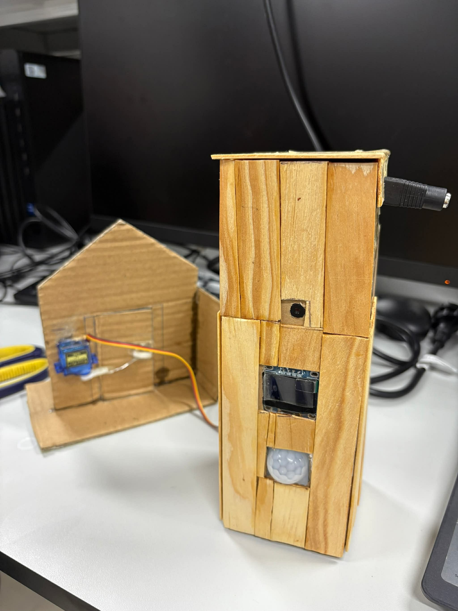
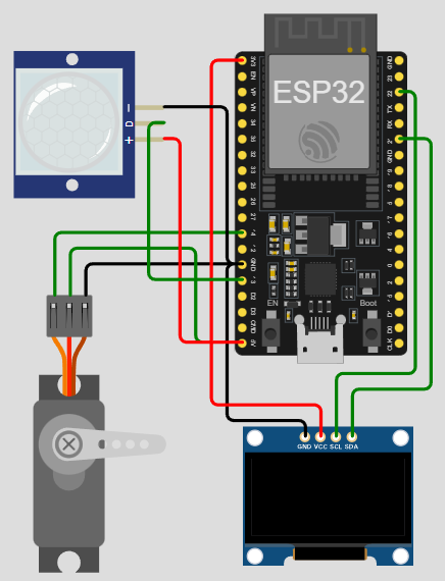

# Face Recognition Attendance System with ESP32

A group project combining an ESP32-CAM, an ESP32 controller, and a Python desktop/server environment for face recognition, attendance display, and a servo-operated door latch.

The repository contains the original project source files and selected existing images. The source files retain their original behavior and configuration style. This README explains how those files fit together and identifies dependencies that are absent from the supplied source.



## System Architecture

The system has three main components:

| Component | Function |
| --- | --- |
| ESP32-CAM with OV2640 | Capture images and provide a camera stream over Wi-Fi |
| ESP32 controller | Read the PIR sensor, handle HTTP requests, control the servo, and update the OLED |
| PC running Python | Receive camera frames, recognize faces, provide the Streamlit interface, and request controller actions |

The main workflow is:

1. The ESP32 controller exposes the PIR sensor state through `/check_pir`.
2. The Streamlit application polls that endpoint while waiting for motion.
3. When motion is detected, the PC opens the ESP32-CAM stream and performs recognition.
4. A recognized identity causes the PC to call `/open?name=...`.
5. An unsuccessful recognition causes a request to `/fail` and offers registration through the interface.
6. The controller's FreeRTOS task handles the servo and display operation while the web server continues handling requests.

[View the project's workflow diagram](images1/flowchart.png).

## Files

| Path | Purpose |
| --- | --- |
| [`recognitionFace.py`](recognitionFace.py) | Original Streamlit recognition and enrollment application using `face_recognition` |
| [`InsightFace.py`](InsightFace.py) | Original alternative Streamlit application using InsightFace |
| [`RTOS2.ino`](RTOS2.ino) | Original ESP32 controller firmware for PIR, servo, OLED, HTTP, and FreeRTOS |
| [`esp32cam.ino`](esp32cam.ino) | ESP32-CAM sketch provided in the group's camera repository |
| [`enroll.py`](enroll.py) | Original OpenCV enrollment utility from the group's Python repository |
| [`requirements.txt`](requirements.txt) | Original dependency listing from the group's Python repository |
| [`test.py`](test.py) | Original camera snapshot and face-detection diagnostic |
| [`test2.py`](test2.py) | Original standalone recognition/streaming script that can send controller commands |
| [`images1/`](images1/) | Existing schematic, workflow, and prototype images |

Reports and presentation files are omitted. The files named `test.py` and `test2.py` are hardware-dependent diagnostic/application scripts, rather than an automated regression test suite.

## Hardware and Wiring

| Component | Purpose |
| --- | --- |
| ESP32 DevKit | Controller running Wi-Fi, WebServer, and FreeRTOS |
| ESP32-CAM / OV2640 | Camera node |
| PIR sensor, such as HC-SR501 | Motion detection |
| SSD1306 OLED, 128 × 64 | Status and identity display |
| Servo, such as SG90 | Demonstration door-latch movement |

The controller firmware defines the following connections:

| Signal | ESP32 controller pin |
| --- | --- |
| PIR output | GPIO14 |
| Servo signal | GPIO13 |
| OLED SDA | GPIO21 |
| OLED SCL | GPIO22 |
| OLED address | `0x3C`, with an initialization fallback to `0x3D` |



Use an appropriate servo supply and common ground with the controller. ESP32 GPIO signals use 3.3 V logic. The controller's pin assignments are separate from the ESP32-CAM's internal camera connections.

## ESP32 Controller Firmware

Open `RTOS2.ino` in an Arduino ESP32 development environment. If the IDE asks to place the sketch in a matching folder, keep the filename and folder name consistent.

The source uses:

- `WiFi`, `WebServer`, `Wire`, and the ESP32 FreeRTOS APIs.
- Adafruit GFX Library.
- Adafruit SSD1306.
- ESP32Servo.

Set the `ssid` and `password` variables in the original firmware for the local Wi-Fi network. Their uploaded values are placeholders; only the Wi-Fi strings were replaced, while the original firmware logic is retained. Upload to the controller and open Serial Monitor at **115200 baud** to obtain its IP address.

### FreeRTOS Behavior

- `servoQueue` carries commands from the HTTP handlers to `TaskServoControl`.
- `oledMutex` protects display updates.
- The servo task is pinned to core 1.
- A successful-recognition command opens the servo to 180°, waits approximately 8 seconds, returns to 0°, waits approximately 1 second, and detaches the servo.
- A failure command displays an OLED warning for approximately 5 seconds.

### Controller HTTP Endpoints

| Request | Behavior |
| --- | --- |
| `GET /check_pir` | Return plain-text `1` when PIR is HIGH, otherwise `0` |
| `GET /open?name=User01` | Submit a name to the servo/display queue; return `CMD_SENT` |
| `GET /fail` | Submit the original failure-display command; return `FAIL_SENT` |
| `GET /scan` | Display the scanning status; return `OK` |

The original handlers do not inspect the return value of `xQueueSend`. Their HTTP responses therefore do not confirm that a queue operation or physical servo movement succeeded.

## ESP32-CAM Source and Required Camera Files

The supplied `esp32cam.ino` configures the AI Thinker camera model and includes the camera initialization and Wi-Fi setup.

It references additional camera example files/functions:

- `camera_pins.h`.
- `startCameraServer()`.
- `setupLedFlash()` when the LED pin is defined.

Those accompanying implementations are absent from the supplied group repositories. The sketch must be used with its matching original camera example tabs/dependencies to build successfully. No replacement camera-server implementation is included here.

The Python applications expect these camera endpoints:

| Endpoint | Used by |
| --- | --- |
| `http://<camera-ip>:81/stream` | Streamlit applications, enrollment utility, and standalone streaming script |
| `http://<camera-ip>/capture` | `test.py` |

Confirm that the camera firmware used on the board actually exposes those URLs before running the Python applications.

## Python Environment

The group's dependency listing was recorded for a **Python 3.10 / Windows** environment. Use an environment compatible with the selected backend and its native dependencies.

From the repository root:

```powershell
py -3.10 -m venv .venv
.\.venv\Scripts\python.exe -m pip install -r requirements.txt
```

The original `requirements.txt` includes local `file:///C:/...` and `file:///D:/...` references for dlib and NumPy. Those paths are specific to the original machine. They must exist or be adjusted in your local environment before installing that dependency listing.

The default application's direct imports require Streamlit, OpenCV, `face_recognition`, NumPy, pandas, and requests. The optional `InsightFace.py` application additionally needs InsightFace and a suitable ONNX Runtime provider. The original requirements listing does not include those optional packages.

dlib may require native build tools when a compatible prebuilt installation is unavailable.

## Configure Device Addresses

The original applications use constants inside each script, rather than a shared configuration file. Run commands from the repository root so their relative `dataset/` paths resolve consistently.

| File | Configuration to check |
| --- | --- |
| `recognitionFace.py` | `ESP32_CAM_IP` and `ESP32_CONTROL_IP` |
| `InsightFace.py` | `ESP32_CAM_IP` and `ESP32_CONTROL_IP` |
| `enroll.py` | The literal `URL_STREAM` value |
| `test.py` | `IP_CAM` and the derived `URL_CAPTURE` |
| `test2.py` | `IP_CAM` and `IP_CONTROL` |

In the original enrollment utility, changing `ESP32_CAM_IP` alone does not change the separately hard-coded `URL_STREAM` string. Set the stream URL itself.

Keep the PC and both ESP32 devices reachable on the same local network. Use the camera node's address for video and the controller node's address for PIR/servo/OLED operations.

## Run the Streamlit Applications

### Default Backend: face_recognition

```powershell
.\.venv\Scripts\python.exe -m streamlit run recognitionFace.py
```

This application loads enrolled images, computes face encodings, and matches using the original `TOLERANCE = 0.50` setting.

### Alternative Backend: InsightFace

After installing the additional backend dependencies:

```powershell
.\.venv\Scripts\python.exe -m streamlit run InsightFace.py
```

The original application uses `FaceAnalysis(name='buffalo_s', providers=['CPUExecutionProvider'])`. Prepare the corresponding model package in the InsightFace environment. Model weights are not included in this repository.

Its original cosine-similarity threshold is `SIMILARITY_THRESHOLD = 0.50`. A larger cosine similarity indicates a closer match, while a smaller `face_recognition` distance indicates a closer match; the two metrics are different.

Open the local URL printed by Streamlit. The application interface retains its original Vietnamese labels.

## Enrollment

### Initial Images with the Original OpenCV Utility

Create the initial local image set using:

```powershell
.\.venv\Scripts\python.exe enroll.py
```

Enter the identity when prompted, look at the camera, press **S** to save the frame, or **Q** to exit. The utility opens an OpenCV window and saves `dataset/<name>.jpg`.

Use simple ASCII identifiers without underscores or path separators. The original applications derive identity labels from the part of the filename before the first underscore.

Populate the dataset before relying on the default recognition application: its original matching path can fail when the known-encoding list is empty.

### Three-Angle Registration in Streamlit

After an unsuccessful recognition attempt, the interface offers **“Đăng ký ngay”**. Enter the identity and follow the front/left/right capture sequence. The saved filenames are:

```text
dataset/User01_front.jpg
dataset/User01_left.jpg
dataset/User01_right.jpg
```

Keep exactly one face visible during registration. The original application counts consecutive detections to decide when to capture; it does not verify the requested head pose or perform liveness detection.

Enrollment photographs are local input data and are not bundled in this curated source collection.

## Original Diagnostics

### Snapshot and Detection Check

```powershell
.\.venv\Scripts\python.exe test.py
```

This downloads a camera snapshot, decodes it with OpenCV, runs face detection, and opens a display window.

### Standalone Streaming Application

```powershell
.\.venv\Scripts\python.exe test2.py
```

This alternative application polls PIR, processes a camera stream, and sends controller commands. Configure its addresses and enrollment images before use. It can operate the servo through the original HTTP endpoints.

## Current Behavior and Limitations

- Attendance history is held in the current Streamlit session. The supplied applications do not implement automatic persistent CSV or SQL storage.
- Network addresses, Wi-Fi credentials, thresholds, and timing values remain in the original source files.
- The two recognition applications retain different countdown and cooldown behavior.
- The camera sketch still requires the original missing camera example dependencies described above.
- The controller uses unauthenticated HTTP commands and the original queue-handling behavior.
- Recognition accuracy, response time, firmware compilation, and physical operation have not been newly validated for this source collection. No automated test results are claimed here.
