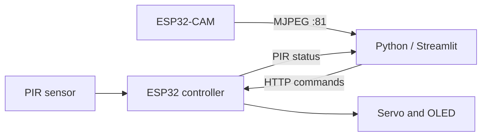

# ESP32 Face Recognition Attendance System

**ESP32-CAM · FreeRTOS controller · Streamlit dashboard · face_recognition / InsightFace**

A connected prototype for face-based attendance and a servo-driven door latch. An ESP32-CAM provides video, a PC performs face recognition, and a separate ESP32 reads a PIR sensor and drives the servo and OLED display. The PC dashboard also supports enrolling new identities from three viewing angles.


## Features

- **Two-device embedded design:** one AI Thinker ESP32-CAM for imaging and one ESP32 DevKit for motion sensing and actuation.
- **Complete camera firmware:** JPEG snapshots on port 80 and MJPEG streaming on port 81, with the camera pin map and HTTP implementation included.
- **PIR-triggered recognition:** the dashboard polls the controller and starts a recognition attempt when motion is detected.
- **Two recognition backends:** the default app uses the dlib-based `face_recognition` library; an optional app uses InsightFace `buffalo_s` with ONNX Runtime on the CPU.
- **FreeRTOS actuation:** a queue transfers commands to a servo task, and a mutex protects the OLED. The web server remains available during the door hold interval.
- **Enrollment:** live front/left/right capture in Streamlit, plus a small JPEG snapshot enrollment tool.
- **Attendance display:** recognized, unknown, enrollment, and controller-error events are shown in the current Streamlit session.
- **Portable configuration:** both apps use the same device URLs and dataset path; Wi-Fi credentials belong in local firmware configuration files.

## Architecture



### Runtime Sequence

1. The controller samples the PIR input and exposes its value through `/check_pir`.
2. The dashboard polls this endpoint while waiting for motion.
3. When motion is detected, the PC opens the camera stream and compares a detected face with locally enrolled images.
4. A match causes a request to `/open?name=...`; an unsuccessful attempt causes a request to `/fail`.
5. The controller queues the operation. Its worker opens the servo to 180°, holds for approximately 8 seconds, returns to 0°, waits 1 second, and detaches the servo.
6. An unsuccessful recognition shows an OLED warning for approximately 5 seconds. The dashboard offers enrollment or a return to the waiting state.

Recognition runs on the PC. The ESP32-CAM captures images, while the second ESP32 handles the sensor, display, and actuator. Communication uses HTTP; the dashboard runs in Streamlit.

[View the original workflow diagram](images1/flowchart.png).

## Repository Layout

| Path | Purpose |
| --- | --- |
| [`recognitionFace.py`](recognitionFace.py) | Default Streamlit app using `face_recognition` |
| [`InsightFace.py`](InsightFace.py) | Alternative Streamlit app using InsightFace / ONNX Runtime |
| [`project_config.py`](project_config.py) | Shared settings, identity handling, matching helper, and controller requests |
| [`config.example.ini`](config.example.ini) | Device URLs, dataset path, and recognition settings |
| [`enroll.py`](enroll.py) | Save one named enrollment snapshot from the camera |
| [`firmware/esp32_cam/`](firmware/esp32_cam/) | Camera sketch, AI Thinker pins, HTTP snapshot and MJPEG server |
| [`firmware/esp32_control/`](firmware/esp32_control/) | FreeRTOS controller for PIR, servo, and OLED |
| [`tools/check_devices.py`](tools/check_devices.py) | Read-only checks for PIR, JPEG, and MJPEG endpoints |
| [`tests/test_project.py`](tests/test_project.py) | Offline configuration, matching, resource cleanup, and HTTP regressions |
| [`dataset/`](dataset/) | Local enrollment images; only the directory placeholder is tracked |
| [`images1/`](images1/) | Existing schematic, workflow, and prototype images |
| [`requirements.txt`](requirements.txt) | Default Python backend dependencies |
| [`requirements-insightface.txt`](requirements-insightface.txt) | Optional InsightFace backend dependencies |

Reports, presentation files, runtime logs, model weights, cache files, local configuration, and enrolled face photographs are excluded from commits. The firmware sketches each reside in a folder matching their `.ino` filename, as expected by the Arduino IDE.

## Hardware

| Component | Role |
| --- | --- |
| AI Thinker ESP32-CAM with OV2640 | Wi-Fi camera; PSRAM enables the default VGA configuration |
| ESP32 DevKit | FreeRTOS controller and HTTP command server |
| PIR sensor, such as HC-SR501 | Motion input |
| SSD1306 OLED, 128 × 64 | Status, identity, and time display |
| Servo, such as SG90 | Demonstration door-latch actuator |
| USB/serial programmer and suitable power supplies | Programming and device power |

### Controller Wiring

| Connection | ESP32 controller pin |
| --- | --- |
| PIR output | GPIO14 |
| Servo signal | GPIO13 |
| OLED SDA | GPIO21 |
| OLED SCL | GPIO22 |
| OLED address | `0x3C`, with `0x3D` fallback |
| Ground | Common ground between connected components |


Power the servo from an appropriate supply and share ground with the controller. ESP32 GPIO signals use 3.3 V logic. The ESP32-CAM uses its own board-specific camera pin map in `camera_pins.h`; its camera signals are not wired to the controller's PIR/OLED pins.

## 1. Prepare and Program the Firmware

Use the Arduino IDE with Arduino-ESP32 **3.x** and the appropriate board definitions. The camera implementation uses Espressif's `esp_camera` and `esp_http_server` APIs; its interface and pin mapping were checked against the Arduino-ESP32 3.0.7 reference.

For the controller, install these Arduino libraries:

- Adafruit GFX Library
- Adafruit SSD1306, including its Library Manager dependencies
- ESP32Servo compatible with the selected Arduino-ESP32 core

`WiFi`, `WebServer`, `Wire`, and FreeRTOS are supplied by the ESP32 core. The camera APIs are supplied by Arduino-ESP32.

### Configure Wi-Fi

In **each** firmware folder, copy `config.example.h` to `config.h` and enter the network credentials:

```cpp
#pragma once
#define WIFI_SSID "YOUR_WIFI_SSID"
#define WIFI_PASSWORD "YOUR_WIFI_PASSWORD"
```

Local `config.h` files are ignored by Git.

### ESP32-CAM

1. Open `firmware/esp32_cam/esp32_cam.ino`; keep its `.cpp` and `.h` files in the same sketch folder.
2. Select the AI Thinker ESP32-CAM board and the correct serial port. Enable PSRAM for a board that provides it.
3. Upload using the board's required programming procedure, then restart in normal boot mode.
4. Open Serial Monitor at **115200 baud** and record the printed IP address.
5. Check `http://<camera-ip>/capture` and `http://<camera-ip>:81/stream`.

The camera uses VGA JPEG frames when PSRAM is available and QVGA otherwise. The dedicated stream server lets the snapshot endpoint remain on port 80.

### ESP32 Controller

1. Open `firmware/esp32_control/esp32_control.ino` and select the matching dual-core ESP32 DevKit board.
2. Connect the PIR, servo, and OLED according to the table above, then upload.
3. Record the controller IP from Serial Monitor at **115200 baud**.
4. Visit `http://<controller-ip>/check_pir`: the response should be `0` or `1`.

The controller continues operating without an OLED if display initialization fails. Queue or task allocation failures are reported through Serial Monitor.

## 2. Configure the Python Applications

Copy `config.example.ini` to **`config.ini`** in the repository root and replace the sample IP addresses:

```ini
[devices]
camera_stream_url = http://192.168.1.50:81/stream
camera_capture_url = http://192.168.1.50/capture
controller_url = http://192.168.1.51

[paths]
dataset_dir = dataset

[recognition]
face_distance_threshold = 0.50
similarity_threshold = 0.50
capture_timeout_seconds = 30
```

Both apps, the enrollment tool, and the device checker read this configuration. Relative dataset paths are resolved from the repository root, independently of the current working directory. Without a local file, sample addresses are used; configure the real addresses before connecting hardware.

Environment variables can override individual settings: `ESP32_CAM_URL`, `ESP32_CAM_CAPTURE_URL`, `ESP32_CONTROL_URL`, `FACE_DATASET_DIR`, `FACE_DISTANCE_THRESHOLD`, `FACE_SIMILARITY_THRESHOLD`, and `FACE_CAPTURE_TIMEOUT`.

## 3. Install and Run a Recognition Backend

Use a dedicated environment with **Python 3.10 or 3.11**. The shared dependencies use headless OpenCV because image display is handled by Streamlit.

### Default: face_recognition / dlib

From the repository root, on Windows:

```powershell
py -3.10 -m venv .venv
.\.venv\Scripts\python.exe -m pip install --upgrade pip
.\.venv\Scripts\python.exe -m pip install -r requirements.txt
.\.venv\Scripts\python.exe -m streamlit run recognitionFace.py
```

On Linux/macOS, use the corresponding interpreter under `.venv/bin/`:

```bash
python3 -m venv .venv
.venv/bin/python -m pip install --upgrade pip
.venv/bin/python -m pip install -r requirements.txt
.venv/bin/python -m streamlit run recognitionFace.py
```

The `face_recognition` package depends on dlib. If a compatible wheel is unavailable, installing dlib requires CMake and a supported C++ build toolchain. An environment that already provides a compatible dlib installation is another option. The dependency files contain package names and version constraints rather than machine-specific wheel paths.

### Optional: InsightFace / CPU

Install this profile in a separate environment:

```bash
python -m pip install -r requirements-insightface.txt
python -m streamlit run InsightFace.py
```

This application retains the **InsightFace 0.7.3** API used by the project and explicitly selects ONNX Runtime's CPU provider. Obtain the `buffalo_s` model package through InsightFace's model setup process; models are stored under `~/.insightface/models/`. The model weights are not included in this repository. Check the upstream terms for the chosen pretrained model before using it.

Open the local URL printed by Streamlit, usually `http://localhost:8501`. The existing dashboard labels are primarily Vietnamese; this README documents both backends in English.

### Matching Thresholds

| Backend | Score | Default acceptance rule |
| --- | --- | --- |
| `recognitionFace.py` | dlib face-encoding distance; lower is closer | Distance ≤ `0.50` |
| `InsightFace.py` | Cosine similarity; higher is closer | Similarity > `0.50` |

These two thresholds represent different metrics. Tune them against representative enrollment images and test captures rather than treating them as interchangeable accuracy percentages.

## 4. Enroll Identities

### Streamlit: Live Three-Angle Capture

Select **“Đăng ký khuôn mặt”** in the sidebar. Enter an identifier such as `User01` or `User_01`, then follow the front/left/right prompts. The app captures one visible face after a stable detection sequence and reloads its enrollment cache when registration completes.

Supported identifiers contain 1–40 ASCII letters, digits, underscores, or hyphens and start with a letter or digit. Images are stored as:

```text
dataset/User01_front.jpg
dataset/User01_left.jpg
dataset/User01_right.jpg
```

An empty dataset is supported: enroll an identity from the sidebar before attempting a successful match. Registration can also be started after an unsuccessful recognition attempt.

### CLI: Single JPEG Snapshot

```bash
python enroll.py --name User01 --pose front
python enroll.py --name User01 --pose left
python enroll.py --name User01 --pose right
```

The tool asks you to position your face, then saves a snapshot from the camera's `/capture` endpoint when you press Enter. It checks the response type and JPEG signature; it does not perform face-quality validation. Use Streamlit for live preview and face-guided capture. Restart the recognition app after adding files with the CLI so its cached database reloads.

## HTTP API

| Device | Request | Response or action |
| --- | --- | --- |
| Camera, port 80 | `GET /` | Camera service information |
| Camera, port 80 | `GET /capture` | JPEG image |
| Camera, port 81 | `GET /stream` | MJPEG multipart stream |
| Controller, port 80 | `GET /check_pir` | Plain-text `0` or `1` |
| Controller, port 80 | `GET /scan` | Show scanning status; optional display endpoint |
| Controller, port 80 | `GET /open?name=User01` | Queue a servo/OLED operation; `200 CMD_SENT` |
| Controller, port 80 | `GET /fail` | Queue a recognition-failure display; `200 FAIL_SENT` |
| Controller, port 80 | `/open` or `/fail` when the queue is full | `503 QUEUE_FULL` |

A `200` control response confirms that a command was queued; it does not verify physical servo movement. The dashboard distinguishes recognition from a failed controller request and records a controller-error status when the command is not accepted. The normal recognition flow uses `/check_pir`, `/open`, and `/fail`.

## Diagnostics and Validation

Before starting recognition, check the configured devices:

```bash
python tools/check_devices.py
```

This checks PIR status, a JPEG response, and an MJPEG response without sending actuator commands.

Run the offline tests without a camera, face database, or AI packages:

```bash
python -m unittest discover -s tests -v
```

The nine regression tests cover configuration overrides, invalid settings, safe enrollment identifiers, identity parsing, empty/invalid distance results, empty-dataset handling in both backends, camera release on recognition errors, URL-encoded controller requests, and queue-full responses. They passed during this update, alongside Python syntax and CLI entry-point checks.

The ESP32 sketches have not been compiled or flashed during this update. Full recognition accuracy, model loading, network performance, and physical servo/OLED behavior require validation on the actual setup.

## Troubleshooting and Current Limits

| Symptom | Check |
| --- | --- |
| Camera cannot be opened | Confirm the camera IP, port 81, `/stream` path, Wi-Fi reachability, power, and PSRAM/board selection |
| Snapshot tool fails | Check the separate port-80 `/capture` URL in `config.ini` |
| Camera connects but nothing matches | Enroll clear images, inspect framing/lighting, and verify the selected backend and its threshold |
| Camera enrollment stops without saving | Retry after checking the stream and ensuring exactly one face is visible; the enrollment search loop has a configurable timeout |
| PIR never changes | Check GPIO14, common ground, sensor power, and the PIR module's warm-up/hold settings |
| OLED stays blank | Check GPIO21/GPIO22, power, and address `0x3C`/`0x3D` |
| Servo does not move after recognition | Check the controller response, queue availability, GPIO13, servo power, and shared ground |
| An added image is not recognized | Restart after external file changes; use a supported image extension and a filename matching the identity convention |
| dlib or InsightFace installation fails | Use a dedicated supported Python environment and install the native build tools required by that backend |

- Attendance history currently lives in the **Streamlit session**. Persistent CSV/SQL storage is a possible extension.
- The recognition loops and PIR polling introduce latency; the two backends use different scan/countdown timings. No recognition-accuracy or response-time benchmark is asserted here.
- The enrollment stability check counts detections; it is not a liveness or anti-spoofing system.
- The controller API is unauthenticated HTTP, intended for a trusted local-network prototype. Additional access controls and physical-security validation are needed for deployment beyond that setting.
